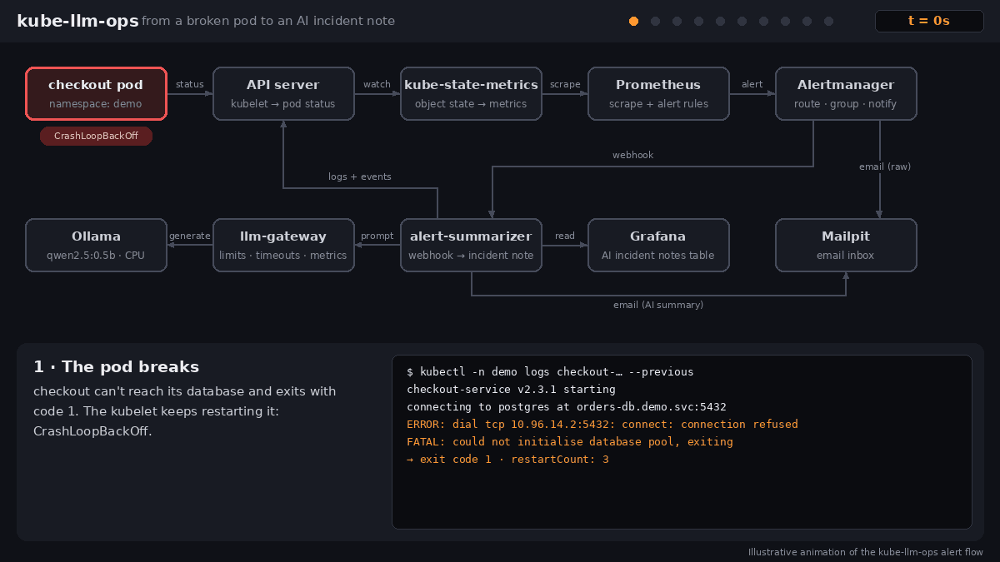
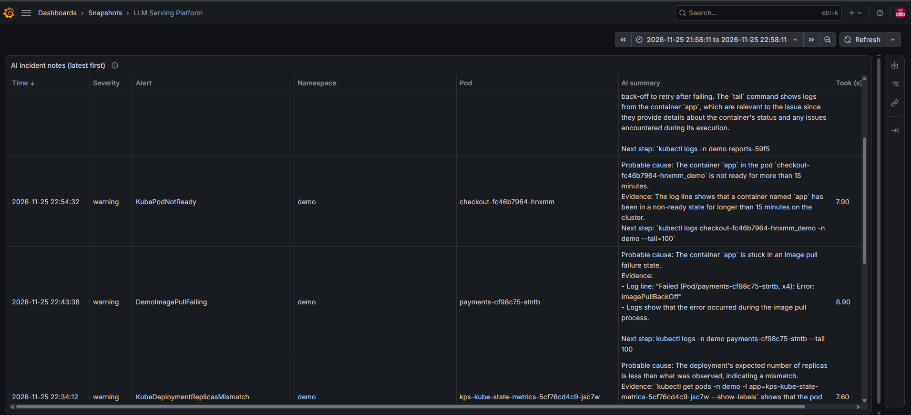
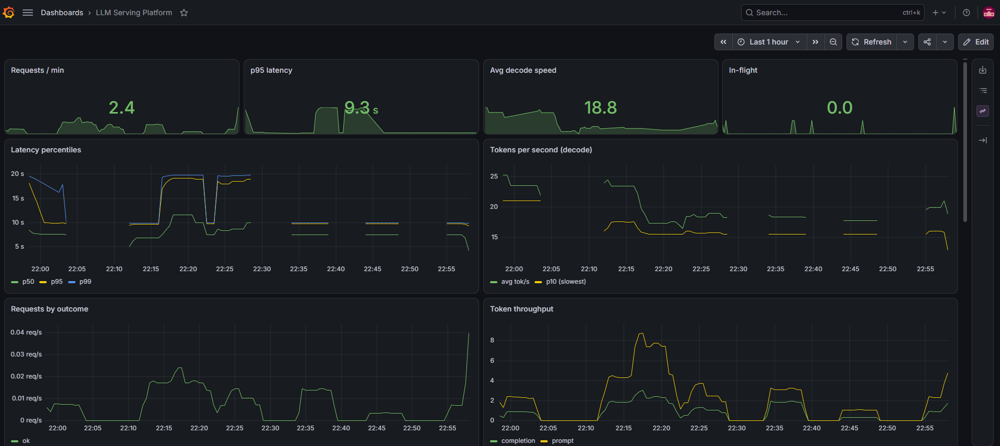
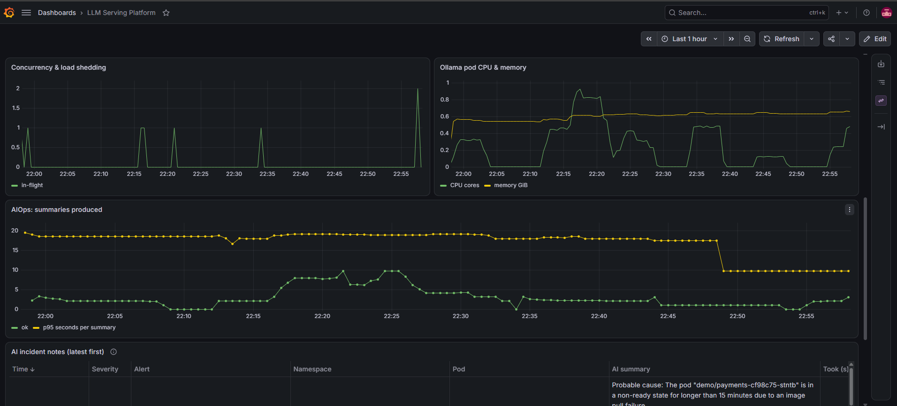
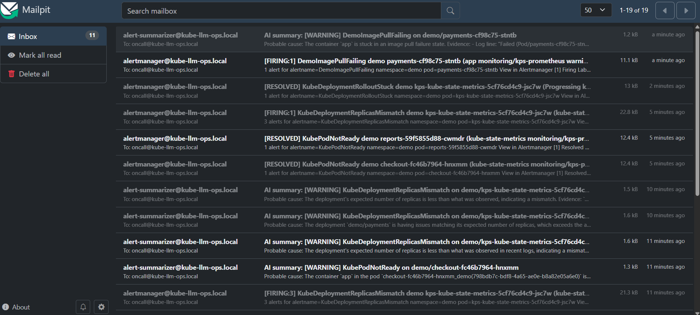
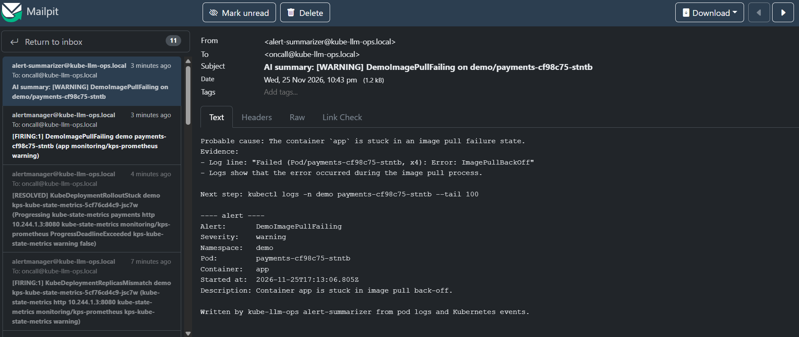
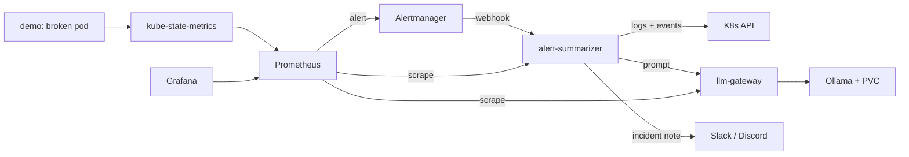

# kube-llm-ops


**A self-hosted LLM platform on Kubernetes, plus an AIOps service that uses it to write incident summaries from Prometheus alerts.**

Runs entirely on a laptop with kind: no cloud account, no GPU, no API keys.


<sub>How an alert travels through the stack, from the crashed pod to the AI incident note (about 2 minutes end to end).</sub>


<sub>Each row is an alert Prometheus fired, with the incident note the self-hosted LLM wrote from that pod's logs and events. Wording varies by model.</sub>

## What it does

| | |
|---|---|
| **LLM serving** | Ollama (`qwen2.5:0.5b` on CPU) behind a FastAPI **gateway** that adds concurrency limits with 429 load shedding, timeouts, model-aware readiness, and Prometheus metrics for latency, tokens/sec, token throughput and cold starts. |
| **Observability as code** | Grafana dashboard, ServiceMonitors and SLO alert rules ship with the Helm chart. |
| **AIOps** | Alertmanager sends a webhook to **alert-summarizer**, which pulls pod logs and K8s events (read-only RBAC), asks the gateway for a three-line incident note, and delivers it by email, Slack or Discord and to a Grafana table. If the LLM is down, it still sends the raw events. |
| **Chaos scenarios** | `make break SCENARIO=crashloop|bad-image|oom` shows the whole loop in about 2 minutes. |

## Screenshots

<table>
  <tr>
    <td width="50%"><br><sub><b>LLM serving metrics</b>: latency percentiles, tokens/sec and token throughput from the gateway.</sub></td>
    <td width="50%"><br><sub><b>Capacity and AIOps</b>: in-flight requests, Ollama CPU/memory, and summaries produced.</sub></td>
  </tr>
  <tr>
    <td width="50%"><br><sub><b>Two emails per alert</b>: the raw alert from Alertmanager, then the AI summary.</sub></td>
    <td width="50%"><br><sub><b>AI summary email</b> for the <code>bad-image</code> scenario: probable cause, evidence, next step.</sub></td>
  </tr>
</table>

## Architecture



More detail: [docs/architecture.md](docs/architecture.md). Hosting the LLM: [docs/llm-hosting.md](docs/llm-hosting.md). Design decisions and trade-offs: [docs/decisions.md](docs/decisions.md).

## Quick start

**Prerequisites:** Docker (8 GB+ RAM allocated), [kind](https://kind.sigs.k8s.io/), kubectl, Helm 3, make. On Windows, use WSL2.

```bash
make up                         # cluster + monitoring + LLM + summarizer (~10 min first time)
make ask                        # prompt through the gateway, prints answer + tokens/sec
make break SCENARIO=crashloop   # break an app...
kubectl -n aiops logs -f deploy/alert-summarizer   # ...and watch the AI incident note arrive
make summaries                  # latest summaries as JSON
make grafana                    # http://localhost:3000  (admin/admin) -> "LLM Serving Platform"
./scripts/load-test.sh 8        # see queueing + 429s on the dashboard
make fix && make down
```

Use a different model: `make llm MODEL=llama3.2:1b`

Step-by-step hosting guide, model sizes, tuning and troubleshooting: [docs/llm-hosting.md](docs/llm-hosting.md)

Send notes to Slack or Discord:
```bash
kubectl -n aiops create secret generic notify-webhook --from-literal=url='https://hooks.slack.com/services/...'
helm upgrade alert-summarizer charts/alert-summarizer -n aiops --reuse-values \
  --set notify.kind=slack --set notify.existingSecret=notify-webhook
```

## Email notifications

Every alert sends **two emails**:

| Email | Sent by | When | Contains |
|---|---|---|---|
| Raw alert | Alertmanager (`email_configs`) | As soon as the alert fires, and again when it resolves | Alert name, labels, annotations |
| AI summary | alert-summarizer (`notify.kind=email`) | After the LLM finishes (~10-60s later on CPU) | Probable cause, evidence, next step + alert details |

By default both go to **Mailpit**, a local SMTP server with a web inbox that runs in the cluster (`deploy/mail/mailpit.yaml`). No email account is needed and nothing leaves your machine:

```bash
kubectl apply -f deploy/mail/mailpit.yaml
make break SCENARIO=crashloop
kubectl -n mail port-forward svc/mailpit 8025:8025    # http://localhost:8025
```

### Sending to a real inbox (Gmail)

1. Turn on 2-Step Verification on the Google account, then create an **app password** (Google Account → Security → App passwords). Your normal password will not work over SMTP.
2. **AI summary emails** (alert-summarizer):
   ```bash
   kubectl -n aiops create secret generic smtp-auth \
     --from-literal=username='you@gmail.com' --from-literal=password='<app password>'
   helm upgrade alert-summarizer charts/alert-summarizer -n aiops --reuse-values \
     --set smtp.host=smtp.gmail.com --set smtp.port=587 --set smtp.starttls=true \
     --set smtp.from=you@gmail.com --set smtp.to=you@gmail.com --set smtp.existingSecret=smtp-auth
   ```
3. **Raw alert emails** (Alertmanager): create the same secret in `monitoring`, mount it, and point `global` at Gmail in `deploy/monitoring/kps-values.yaml`:
   ```bash
   kubectl -n monitoring create secret generic smtp-auth \
     --from-literal=username='you@gmail.com' --from-literal=password='<app password>'
   ```
   ```yaml
   alertmanager:
     alertmanagerSpec:
       secrets: [smtp-auth]          # mounted at /etc/alertmanager/secrets/smtp-auth/
     config:
       global:
         smtp_smarthost: smtp.gmail.com:587
         smtp_from: you@gmail.com
         smtp_auth_username: you@gmail.com
         smtp_auth_password_file: /etc/alertmanager/secrets/smtp-auth/password
         smtp_require_tls: true
       receivers:
         - name: alert-summarizer
           email_configs:
             - to: you@gmail.com
   ```
   Then `make monitoring`.

Any SMTP provider works the same way (host, port, STARTTLS, username/password). If email delivery fails, the summary is still logged, kept for `/summaries` and the Grafana panel, and counted in `summarizer_notify_failures_total`.

## Gateway API

```http
POST /v1/generate
{"prompt": "...", "system": "optional", "max_tokens": 256, "temperature": 0.2}

200 {"model": "qwen2.5:0.5b", "response": "...", "prompt_tokens": 31,
     "completion_tokens": 88, "tokens_per_second": 14.2, "latency_seconds": 6.9}
429 at capacity · 502 upstream error · 504 model timeout
```

| Metric | Type | Why it matters |
|---|---|---|
| `llm_request_duration_seconds` | histogram | user-facing latency (p50/p95/p99) |
| `llm_tokens_per_second` | histogram | decode speed, the real capacity signal for LLMs |
| `llm_tokens_total{type}` | counter | prompt vs completion throughput (cost proxy) |
| `llm_inflight_requests` | gauge | saturation |
| `llm_rejected_requests_total` | counter | load shedding |
| `llm_model_load_seconds` | histogram | cold starts |

## Repository layout

```
apps/llm-gateway/        FastAPI gateway + tests + Dockerfile
apps/alert-summarizer/   Alertmanager webhook -> evidence -> LLM -> notifier
charts/llm-serving/      Ollama, gateway, ServiceMonitor, PrometheusRule, Grafana dashboard
charts/alert-summarizer/ Deployment, least-privilege RBAC, ServiceMonitor
deploy/monitoring/       kube-prometheus-stack values (kind-tuned), fast demo alert rules
deploy/demo/             failure scenarios
scripts/                 break-app, ask, load-test
.github/workflows/       lint, tests, helm lint + kubeconform, image build -> GHCR
```

## Development

```bash
cd apps/llm-gateway && pip install -r requirements-dev.txt && pytest -q
make lint test
```

## Roadmap
Streaming plus a time-to-first-token metric · HPA on in-flight requests (KEDA) · routing across several models · ArgoCD app-of-apps · feedback on summary quality.
