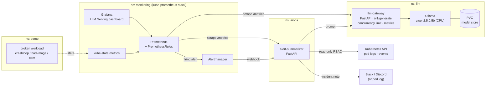

# Architecture

## Goal

Run an LLM the way a platform team would run any shared dependency: behind a stable API, with capacity limits, health checks, metrics, dashboards and alerts. Then show it being used for something real: summarizing production incidents automatically.

Everything runs on a laptop in kind. It needs no cloud account, no GPU and no API keys.

## Components

| Component | Namespace | Responsibility |
|---|---|---|
| **Ollama** | `llm` | Model runtime. Pulls the model on first start and stores it on a PVC, so restarts don't download it again. Readiness passes only once the model is on disk. |
| **llm-gateway** | `llm` | The platform API. One endpoint (`/v1/generate`) for every consumer, a concurrency limit with a bounded queue (429 when full), timeouts, and Prometheus metrics (latency, tokens, tokens/sec, in-flight, rejections, cold-start load time). |
| **kube-prometheus-stack** | `monitoring` | Scrapes the gateway and the summarizer through ServiceMonitors, evaluates alert rules, and routes alerts from `demo`/`llm`/`aiops` to the summarizer. |
| **alert-summarizer** | `aiops` | Alertmanager webhook receiver. For each new firing alert it collects pod logs (from the previous container when one exists) and warning events, asks the gateway for a three-line incident note, and posts it. |
| **demo workloads** | `demo` | Repeatable failure scenarios with fast-firing alert rules. |

## Request flow: AIOps loop

1. `make break SCENARIO=crashloop` deploys an app that can't reach its database.
2. kube-state-metrics shows the restarts, and `DemoPodCrashLooping` fires in about a minute.
3. Alertmanager groups the alert and POSTs it to `alert-summarizer`, which replies immediately and does the work in the background.
4. The summarizer drops alerts it has already handled (same fingerprint and start time), then reads the logs and events using a read-only ClusterRole.
5. It builds a short prompt, trimmed to keep the newest logs because small CPU models need small prompts, and calls `llm-gateway`.
6. The gateway waits for a free slot, calls Ollama, and records latency and token metrics.
7. The note goes to Slack/Discord, or to the pod log by default, and is also available at `GET /summaries`.
8. If the LLM is down, the summarizer still sends the alert with the raw events attached.

## What the platform side shows

| Concern | How it's handled |
|---|---|
| Capacity | `MAX_CONCURRENCY` semaphore plus `QUEUE_TIMEOUT_SECONDS`. Excess load gets a fast 429 instead of stalling the node. `scripts/load-test.sh` shows this on the dashboard. |
| Health | Ollama readiness is model-aware (`ollama show`). Gateway `/readyz` checks that the model is present upstream. A startup probe allows 15 min for the first model pull. |
| Cold starts | PVC model cache, `OLLAMA_KEEP_ALIVE=24h`, and an `llm_model_load_seconds` histogram so cold starts show up on the dashboard. |
| Observability | RED metrics plus LLM-specific ones (tokens/sec, token throughput), a Grafana dashboard shipped as code, and SLO alerts shipped with the chart. |
| Security | Non-root containers, read-only root filesystem, all capabilities dropped. The summarizer gets least-privilege read-only RBAC. Webhook URLs come only from a Secret. |
| Delivery | Helm charts. CI runs lint, tests, `helm lint` and `kubeconform`, then builds images and pushes them to GHCR. |
